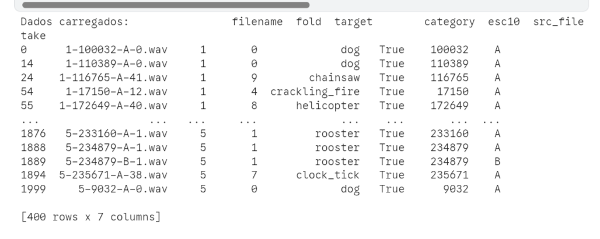
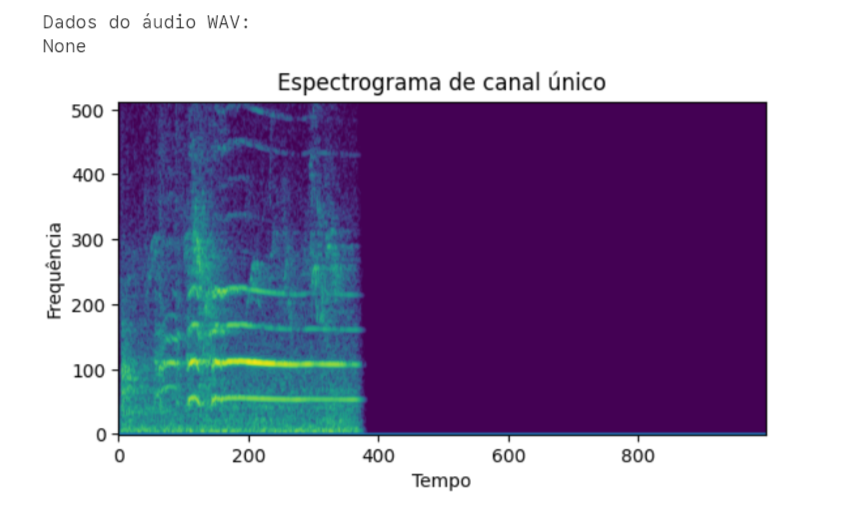
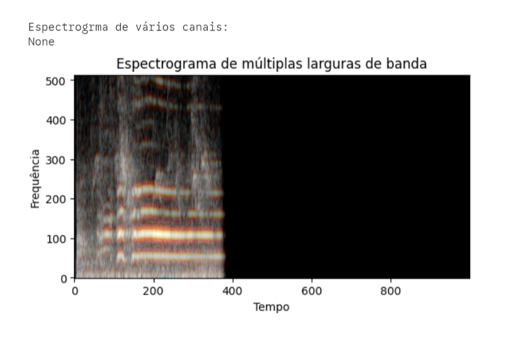

# Classificação de Áudio com STFT e IA (Keras)

## 📌 O que o projeto faz

Este projeto prepara os dados para uma rede neural em Python (Keras) que classifica sons ambientais do dataset **ESC-10**. O áudio é lido, padronizado e transformado em **espectrogramas** com a camada `STFTSpectrogram`, que mostram como as frequências do som mudam ao longo do tempo.

O código está comentado passo a passo, em português, e organizado em **7 etapas práticas**.

---

## 💻 Ambiente de Desenvolvimento

- **Plataforma:** Desenvolvido e executado no **Kaggle**
- **Linguagem:** Python
- **Bibliotecas:** Keras (backend JAX), NumPy, Pandas, SciPy e Matplotlib

---

## 📂 Estrutura do Projeto

- `classificacao_audio_STFT_IA.py`: Código-fonte principal, com a leitura dos dados, o pré-processamento, os espectrogramas e a divisão em treino, validação e teste.
- `imagens/img1.jpg`, `imagens/img2.jpg`, `imagens/img3.jpg`: Registros visuais dos resultados gerados pelo código.

---

## 🚀 Como Usar

1. Clone o repositório em sua máquina.

2. Instale as bibliotecas necessárias: `keras`, `jax`, `numpy`, `pandas`, `scipy` e `matplotlib`.

3. Execute o arquivo `classificacao_audio_STFT_IA.py`.

4. Na primeira execução, o dataset ESC-50 é baixado automaticamente para a pasta `datasets`.

---

## 🧩 Etapas do código

1. Importar as bibliotecas necessárias.
2. Definir as variáveis do projeto (lote, classes, épocas e taxa de amostragem).
3. Baixar o conjunto de dados ESC-50.
4. Ler o arquivo CSV e filtrar apenas as 10 classes do ESC-10.
5. Ler e pré-processar os arquivos WAV (normalização e reamostragem para 16 kHz).
6. Calcular e desenhar o espectrograma de um único canal.
7. Calcular e desenhar o espectrograma de múltiplas larguras de banda e dividir os dados em treino (folds 1, 2 e 3), validação (fold 4) e teste (fold 5).

---

## 🖼️ Imagens do Projeto

### Forma de onda e espectrograma

### Espectrograma de múltiplas larguras de banda

### Saída dos dados carregados

---

## 🛠️ Stack Tecnológica e Referências

- **Keras** (`layers.STFTSpectrogram`): Calcula o espectrograma do áudio. ([Documentação](https://keras.io/api/layers/preprocessing_layers/audio_preprocessing/stft_spectrogram/))
- **NumPy**: Manipulação dos arrays de áudio. ([Documentação](https://numpy.org/doc/stable/))
- **Pandas**: Leitura e filtragem da tabela de metadados. ([Documentação](https://pandas.pydata.org/docs/))
- **SciPy**: Leitura dos arquivos WAV e reamostragem do sinal. ([Documentação](https://docs.scipy.org/doc/scipy/))
- **Matplotlib**: Gráficos da forma de onda e dos espectrogramas. ([Documentação](https://matplotlib.org/stable/))
- **Dataset ESC-50 / ESC-10**: Sons ambientais usados no projeto. ([Repositório](https://github.com/karoldvl/ESC-50))

---

## 🚀 Próximos projetos

Outros projetos de IA serão postados em breve, com níveis de complexidade maiores.

---

## 👤 Autor: Bruno Maker
